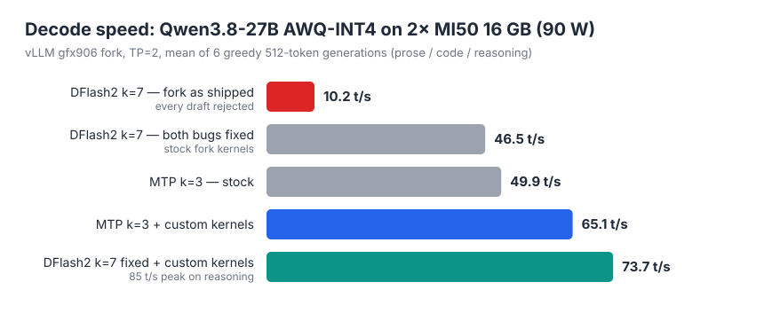
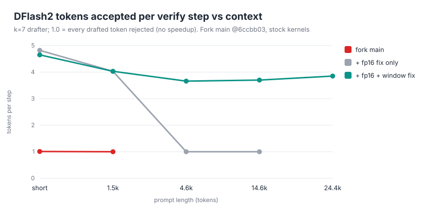

# mi50-vllm-lab

**Qwen3.8-27B on two 2018-era AMD MI50 cards (gfx906, 16 GB each): a 200k-token context for coding agents, 74 t/s with speculative decoding, and three bug fixes for the gfx906 vLLM fork.**

This repo holds everything behind my write-up ([blog post](https://blog.sbm-labs.com/en/posts/mi50-vllm-part-2/)):

- the Docker build;
- the serve profiles I use daily for Hermes Agent and opencode;
- three custom HIP kernels;
- the vLLM patches;
- the benchmark scripts.



## Results

| | Before | After |
|---|---|---|
| DFlash2 (k=7) speculative decoding | 10.2 t/s, every draft rejected | **73.7 t/s** mean, 85 peak |
| MTP (k=3) speculative decoding | 49.9 t/s | **65.1 t/s** with the custom kernels |
| Max context, coding-agent profile | ~96k (fp16 KV) | **200k** (int8 KV); 143k-token prompt verified end to end |
| TP=2 all-reduce without P2P | ~72 µs (RCCL) | **28 µs**, bit-identical |

The cards are passively cooled and power-capped at **90 W each**. Full numbers and methodology are in [`docs/RESULTS.md`](docs/RESULTS.md).

## What I found and fixed

1. **The DFlash2 drafter overflows fp16.** gfx906 has no bf16, so the bf16-trained drafter runs in fp16. By its second layer its residual stream passes 65504 and turns into inf/NaN, and acceptance drops to exactly 0. The fix divides the residual stream by a power of two once, at load time. Every branch reads the stream through an RMSNorm, so the outputs don't change, and it costs nothing at runtime.
2. **The drafter read freed KV-cache blocks.** The fork's non-causal attention path dropped the drafter's 2048-token sliding window. Past ~2–4k context it attended to blocks the cache manager had already freed, and acceptance fell back to 0. The fix keeps the window inside the existing kernel mask (Python only), and a test poisons out-of-window blocks with NaN to catch any regression.
3. **int8 KV crashed at boot.** `triton_attn.py` read a field that vLLM 0.30.0 removed. This was a one-line fix, and it is what unlocks the 200k profile.



Upstream: (1) and (2) are in [PR_DFLASH2_URL](PR_DFLASH2_URL) and (3) in [PR_TRITON_URL](PR_TRITON_URL) against [KIntegrated/vllm-gfx906-mobydick](https://github.com/KIntegrated/vllm-gfx906-mobydick). PR texts and patch series are in [`upstream/`](upstream/).

## Kernels

Speculative decoding verifies k+1 tokens per step, so most matmuls have M ≤ 8 rows. At that size they are bound by memory bandwidth, not compute, and the general GEMM paths handle them badly. [`kernels/`](kernels/) builds one extension, `gfx906_skinny.so`, with three kernels:

| Kernel | What it does | Speedup |
|---|---|---|
| `skinny.cu` | fp16 GEMM for M ≤ 8. Coalesced 16-byte weight loads, activations staged in LDS, butterfly reduction. | lm_head at M=7: 10.3 → 3.4 ms |
| `w4.cu` | 4-bit (Exllama layout) GEMM for M ≤ 8. Each weight is dequantized once and reused for all rows, with fp32 accumulation and no fp16 atomics. | 1.1–1.7× per layer |
| `hostar.cu` | TP=2 all-reduce through pinned host memory with a generation-flag handshake. Safe to replay in CUDA graphs. | 72 → 28 µs |

## Run it

```bash
docker build -t vllm-gfx906-kintegrated:0.30.0-rocm7.14 -f docker/vllm.Dockerfile docker/  # long build; run in tmux
docker/build-opt.sh                      # applies patches/vllm/*.patch and compiles kernels/
MODELS=~/models serve/serve-agent.sh     # 200k context, MTP k=3, tool calling
```

The model directory must hold `cyankiwi/Qwen3.8-27B-AWQ-INT4`, plus `z-lab/Qwen3.8-27B-DFlash2` if you use `serve/serve-dflash2.sh`.

The endpoint is OpenAI-compatible at `http://<host>:8000/v1` with model name `qwen3.8-27b`.

| Script | Use |
|---|---|
| `serve/serve-agent.sh` | Coding agents (Hermes, opencode): int8 KV, 200k context, MTP k=3, one sequence, prefix caching |
| `serve/serve.sh` | MTP general profile. Knobs: `KV_DTYPE`, `MAX_LEN`, `SEQS`, `SPEC_K`, `CAPTURE` |
| `serve/serve-dflash2.sh` | Fastest short-context decode: DFlash2 k=7, up to 32k context, prefix caching off |

## Limits

- At 90 W, prefill is compute-bound: a cold 143k-token prompt takes ~42 min. Later turns reuse the prefix cache and start in 45–75 s.
- The 200k profile serves one sequence. The full 200k length boots, with a 221k-token KV pool, but the longest prompt actually run is 143k.
- DFlash2's 3.6 GB drafter limits it to ~32k context on 16 GB cards, and it needs prefix caching off. For agents, the MTP profile is the one to use.

## How this was built

I set the goals, constraints and hardware, and reviewed the results. The engineering work (reading the fork's code, writing the kernels and fixes, running the A/B measurements) was done with [Claude Code](https://claude.com/claude-code) running as an agent on the box under fixed rules: everything in Docker, host ROCm untouched, builds in tmux with logs. Every number here comes from a logged run.

## Credits

- [KIntegrated/vllm-gfx906-mobydick](https://github.com/KIntegrated/vllm-gfx906-mobydick): the gfx906 vLLM fork this builds on.
- [mixa3607/ML-gfx906](https://github.com/mixa3607/ML-gfx906): the gfx906 PyTorch/ROCm images. `docker/vllm.Dockerfile` is derived from its vllm Dockerfile (MIT).
- [ai-infos/flash-attention-gfx906](https://github.com/ai-infos/flash-attention-gfx906), [vLLM](https://github.com/vllm-project/vllm), [z-lab](https://huggingface.co/z-lab) (DFlash2) and [cyankiwi](https://huggingface.co/cyankiwi) (AWQ quant).

## License

Apache-2.0 (see [LICENSE](LICENSE)). `patches/vllm/` modifies Apache-2.0 vLLM code. `docker/vllm.Dockerfile` is derived from MIT-licensed work (see [NOTICE](NOTICE)).
