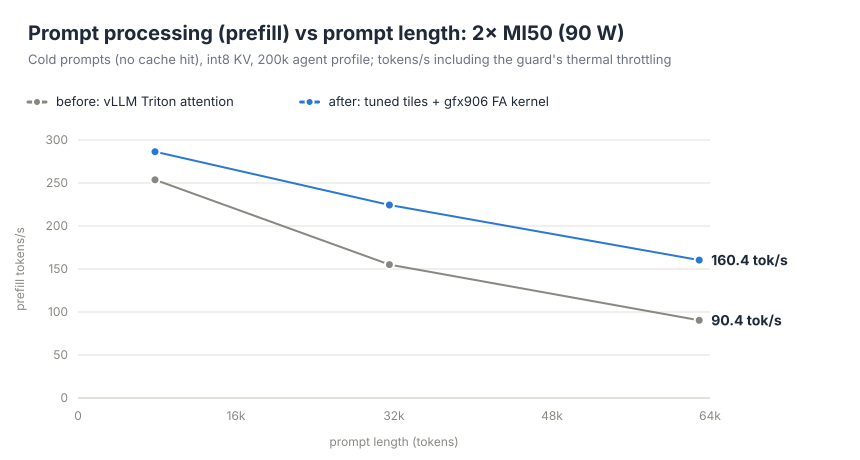
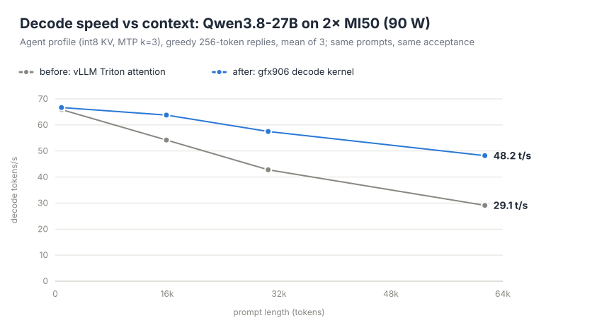
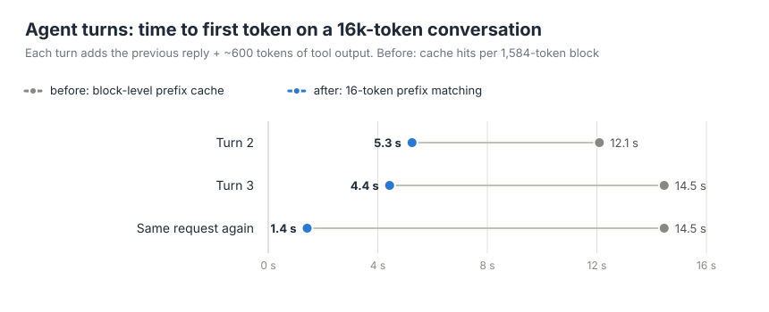

# Results

All numbers were measured on one box between 2026-10-08 and 2026-10-13. Every run used the scripts in `serve/`, `bench/` and `kernels/`; the raw logs behind the 2026-10-12/13 sections are in [`logs/`](logs/).

## Box

| Part | Spec |
|---|---|
| GPUs | 2× AMD MI50 16 GB (gfx906, Vega 20). They report as "Radeon Pro VII" (PCI 0x66a1). Passively cooled. **Power-capped at 90 W each** (the driver default is 190 W). The cooling holds only ~72–78 W per card for long, so a host-side guard lowers the cap as the cards heat up; long runs are throttled below 90 W. |
| Interconnect | PCIe with no GPU peer-to-peer. RCCL goes through host shared memory at ~72–80 µs per all-reduce. |
| Host | Xeon E5-2680 v4, 32 GB DDR4, X99-F8D Plus, Proxmox VE 8 (kernel 6.8.12). vLLM runs in Docker inside an LXC with 10 cores. |
| Software | ROCm 7.14 and PyTorch 2.13 (gfx906 builds by mixa3607), [KIntegrated/vllm-gfx906-mobydick](https://github.com/KIntegrated/vllm-gfx906-mobydick) 0.30.0 @ `6ccbb03`, Triton 3.8.0 |
| Models | `cyankiwi/Qwen3.8-27B-AWQ-INT4` as the target; `z-lab/Qwen3.8-27B-DFlash2` (3.6 GB) as the block-diffusion drafter; MTP from the target's own head |

## How things are measured

- **`bench/bench.py`** runs six chat-templated generations of 512 tokens each: prose, code and reasoning, two reps of each. It reports the mean. Decode t/s is `(completion_tokens - 1) / (t_last_chunk - t_first_chunk)`, so prefill is excluded. Acceptance comes from `/metrics` deltas.
- **`bench/longctx.py`** decodes 384 tokens after a long code-reading prompt.
- **`bench/agentctx.py`** builds a prompt from many distinct vLLM source files, hides a "needle" fact at the top and asks a task at the end. It then sends a follow-up turn on the same conversation. This is the agent-loop pattern.
- **`bench/ppbench.py`** times cold prompts (a nonce at the start defeats the prefix cache) at several lengths, starting each from cool cards, and logs power, clocks and temperatures every second.
- **`bench/decbench.py`** puts a prompt of each length in the prefix cache, then times three greedy 256-token replies on it. It reports t/s, tokens per verify step and ms per step, so a speed change can't hide behind an acceptance change.
- **`bench/turnbench.py`** replays agent turns (previous prompt + reply + ~600 tokens of tool output) and reads prefix-cache hits from `/metrics`; `--siblings` sends three requests that share a long prefix. Replies are saved so configurations can be compared for identical output.
- **`bench/quality.py`** (first-token distribution, top-20 logprobs) and **`bench/decqual.py`** (192 greedy tokens with top-5 logprobs per step) compare two server configurations on the same prompts.
- **`kernels/fa_pth/test_pth.py`** and **`kernels/pth_dec/test_dec.py`** check the attention kernels against a float64 reference and vLLM's Triton kernel on the same int8 cache, then time them.
- Every GPU job runs under **`bench/safe-run.sh`**, which kills the load the moment any sensor reaches 80 °C (see [Thermal safety](#thermal-safety)).

## Short-context decode (greedy, one sequence)

| Config | t/s | Tokens per verify step |
|---|---|---|
| DFlash2 k=7, fork `main` as shipped | 10.21 | 1.01 |
| DFlash2 k=7 + fp16 fix + window fix, stock kernels | 46.54 | 4.65 |
| MTP k=3, stock | 49.94 | 3.22 |
| MTP k=3 + custom kernels | 65.09 | 3.22 |
| **DFlash2 k=7 (fixed) + custom kernels** | **73.66** (85.1 peak, reasoning) | 4.73 |

At temperature 0.7: MTP k=3 stock 45.7, MTP k=3 + kernels 59.6, DFlash2 k=7 + kernels 67.0.

## DFlash2 vs context: the A/B behind the upstream PR

Setup: fork `main` `6ccbb03`, k=7, model-runner V2, TP=2, max-len 32768, KV pinned at 2 GiB, stock kernels. Each cell is decode t/s, with tokens per verify step in parentheses.

| Arm | bench | 1.5k | 4.6k | 14.6k | 24.4k |
|---|---|---|---|---|---|
| `main` | 10.21 (1.01) | 9.65 (1.00) | — | — | — |
| + fp16 rescale only | 48.42 (4.82) | 39.47 (4.03) | 9.61 (1.00) | 8.76 (1.00) | — |
| + rescale + window fix | 46.54 (4.65) | 39.63 (4.03) | 34.84 (3.66) | 32.75 (3.70) | 31.40 (3.85) |

Tests: `test_gfx906_fa.py`, `test_dflash2.py` and `test_dflash_causality.py` give 127 passed. The new window test fails on `main` with "read a freed block outside the window".

## Long context: the agent profile (`serve/serve-agent.sh`)

Settings:

- int8 per-token-head KV with Triton attention (128 softmax segments);
- MTP k=3;
- `--max-model-len 204800` (the KV pool holds 221,748 tokens), up to 4 concurrent requests sharing that pool, prefix caching on;
- `qwen3_coder` tool parser and `qwen3` reasoning parser.

Before the 2026-10-12/13 work (vLLM's Triton attention, block-level prefix cache):

| Prompt | Prefill | Decode | Accept len | Follow-up turn TTFT | Needle |
|---|---|---|---|---|---|
| short | — | 70.2 t/s | — | — | — |
| 62.8k tokens | 107 t/s | 29–32 t/s | — | ~45 s | recalled |
| 143k tokens (160k config) | 57 t/s (2505 s cold) | 17.6 t/s | 3.19 | ~75 s | recalled |

With the gfx906 attention kernels and 16-token prefix matching (current `serve/serve-agent.sh`):

| Prompt | Prefill | Decode | Accept len | Follow-up turn TTFT | Needle |
|---|---|---|---|---|---|
| 58.7k tokens (`agentctx.py 60000`) | 160.4 t/s (366 s cold) | 34.5 t/s straight after the 6-minute cold prefill (hot cards: the guard lowers the cap after long prefills); 48.2 t/s from cool cards (`decbench.py`, 61.4k) | 3.24 | **6.2 s** | recalled |

The 143k prompt has not been re-run with the new kernels.

- With the 200k config, 15,585 MiB per card is in use after boot and 15,843 MiB after a 63k run, which leaves ~520 MiB of headroom per card. The longest prompt actually run is 143k tokens.
- Follow-up turns are cheap because of prefix caching. Qwen3.8 is a hybrid (Gated DeltaNet + attention) model, so vLLM keeps recurrent-state checkpoints in "align" blocks of 1,584 tokens. With block-level matching each turn re-prefilled up to ~2.9k tokens; [16-token matching](#agent-turns-prefix-cache-granularity-2026-10-13) brought that down to the new tokens only.

Concurrency (`bench/conc.py`, 256 greedy tokens per request, short prompts, warm):

| Parallel requests | Per request | Total |
|---|---|---|
| 1 | ~62–70 t/s | ~62–70 t/s |
| 4 | 24–27 t/s | **86.8 t/s** |

Mixing a long prompt with short requests (one 27k-token prompt plus 3 short requests):

| Setting | Long prompt TTFT | Short requests while it is read |
|---|---|---|
| default (2048-token chunks) | 161 s (160 s alone) | ~1.5 t/s |
| `--long-prefill-token-threshold 256` | 200 s (189 s alone) | ~1.9 t/s |

Prefill costs ~6 ms per token at 90 W, so any step that carries prefill tokens is slow, and smaller chunks add per-step overhead on top: the 4-bit GEMM path dequantizes the full weights at M > 8. The profile therefore keeps the default and exposes `LONG_PREFILL=` as a knob.

KV options that were tried:

| KV cache | Max context on 2×16 GB | Why (not) |
|---|---|---|
| fp16 (custom FA) | ~96k | the baseline |
| **int8 per-token-head** | **200k** | ~16.6 KB/token/rank, works with MTP k=3 |
| TurboQuant k8v4 | ~220k | V1 drafter rejects MTP k>1; full CUDA graphs fail on verify; k=1 + piecewise decodes at only 13.1 t/s at 63k |

## Prefill attention (2026-10-12)

On long prompts, attention dominated prefill: at a 143k-token prompt it was ~80 % of the time (from a cost model fitted to the measured prefill runs). vLLM's Triton kernel, which this profile needs for the int8 KV cache, ran at **1.27 TFLOPS per GPU** on gfx906 (`logs/attn_bench.log`, one 2048-token chunk, one layer, one TP rank).

1. **Triton tiles.** The default processes 16 query rows per program, so every K/V tile is loaded and dequantized for only 16 rows. 64 rows reuse each tile 4× more: **~2.3 TFLOPS** at 16k–128k context, same results (`patches/vllm/triton_unified_attention.patch`, gfx906 prefill only).
2. **The fork's gfx906 FA kernel, reading the int8 cache in place.** The fork ships a llama.cpp-derived FlashAttention kernel for gfx906 (Q quantized to q8_0, Q·K with `v_dot4_i32_i8`, P·V in fp16), but only for its own fp16/q8_0 caches. [`kernels/fa_pth`](../kernels/fa_pth/) teaches its paged variant vLLM's int8 per-token-head layout: any block size (here 1,584), the K row's fp32 scale used as the dot-product scale, V converted int8 → fp16 while it is loaded, and no gather copy of the cache. Two precision fixes came out of a comparison against float64: the K × Q scale product and the P·V accumulator are now fp32, which brings the error down to the floor set by the kernel's q8_0 quantization of Q. **4.45 TFLOPS**: 1.93× the tuned Triton kernel, 3.5× the original.

`triton_attn.patch` sends rows with ≥ 64 query tokens to the FA kernel and rows with ≤ 4 to the decode kernel below; anything in between stays on Triton. `VLLM_GFX906_PTH_FA=0` switches the FA path off.

Correctness (`kernels/fa_pth/test_pth.py`, `logs/test_pth.log`): 7 cases (0–20k cached tokens, 5–2,048 query tokens, 1,584-token block edges, HND and NHD layouts) against a float64 reference. The maximum error is ~10× Triton's (e.g. 5.1e-3 vs 4.1e-4 on outputs of mean magnitude 0.027), all of it from the q8_0 quantization of Q; the fork's stock kernel has the same floor. The end-to-end quality checks below show what that costs.

Speed per 2048-token chunk, one layer, one rank:

| Cached context | Triton (64 rows) | gfx906 FA | Speedup |
|---|---|---|---|
| 0 | 12.0 ms | 7.2 ms | 1.66× |
| 16k | 189.6 ms | 98.2 ms | 1.93× |
| 64k | 724.8 ms | 376.2 ms | 1.93× |
| 128k | 1435.2 ms | 747.4 ms | 1.92× |

End to end, cold prompts at the 90 W ceiling (`bench/ppbench.py`, `logs/pp-old.log`, `logs/pp-new.log`):

| Prompt | Before | After | Speedup | Mean power per card |
|---|---|---|---|---|
| 7,800 tokens | 253.7 tok/s (30.7 s) | **286.4 tok/s** (27.2 s) | 1.13× | 92 W |
| 31,531 tokens | 155.1 tok/s (203.3 s) | **224.4 tok/s** (140.5 s) | 1.45× | 85 W |
| 62,910 tokens | 90.4 tok/s (695.7 s) | **160.4 tok/s** (392.2 s) | 1.77× | 75 W (the guard throttled it) |

Quality: the first-token distribution after 4.1k / 17.6k / 34.3k-token prompts, new kernel vs Triton: KL 3.7e-4 / 1.6e-3 / 6.5e-4, and the 8-token greedy continuations are identical (`bench/quality.py`). A 58.7k-token needle test recalled the needle.

## Decode attention (2026-10-13)

With MTP k=3, every decode step verifies 4 tokens per sequence, and with 6 query heads per KV head that is 24 query rows reading the same K/V. Decode attention is therefore compute-bound (~47 FLOP per KV byte), and vLLM's Triton path reached only **~1.1 TFLOPS**: a decode step grew from 46.6 ms at 0.9k context to 99.8 ms at 61k. A sweep of 39 Triton configurations (16/32 query rows, 16–64-key tiles, 2–8 warps, 32/128 softmax segments; `logs/dec_attn_sweep.log`) found none faster than the default.

[`kernels/pth_dec`](../kernels/pth_dec/) is a new split-K decode kernel for the int8 per-token-head cache:

- One workgroup per (split, KV head, sequence), 256 threads, 256-key tiles.
- **Q·K:** each lane owns one key. It converts the key's int8 row to fp16 exactly, once, and computes all 24 scores with `v_dot2_f32_f16` (fp32 accumulation). Q is read with wave-uniform scalar loads, so it costs neither LDS nor vector registers.
- **Online softmax** in base 2; tile maxima and sums are reduced with DPP across the wave and through LDS across the 4 waves.
- **P·V:** each lane owns one output dimension. The probabilities, pre-multiplied by the V row's scale (×256 to stay clear of fp16 subnormals, removed exactly at the end), are staged in LDS; V bytes are read straight from the cache.
- Partial results go into the softmax-segment buffers that vLLM already allocates for its Triton 3D path; a small combine kernel merges them.
- No host synchronization and no allocation: split ranges are derived on the GPU from the sequence lengths, so the kernel runs inside vLLM's captured HIP graphs. A 1-query-token variant serves the MTP drafter, whose layer uses the same attention backend.

Correctness (`kernels/pth_dec/test_dec.py`, `logs/test_dec-15cases.log`): 15 cases against a float64 reference (HND and NHD layouts, padded graph slots, mixed query lengths, 1,584-token block edges, a final split that only some query rows can see, 128k context) at 1, 7, 64 and 128 splits, all passing; the error is within 12 % of Triton's on every case, and often lower.

Speed, one layer, one rank (`logs/test_dec.log`, `logs/dec_var.log`):

| Shape | Triton | gfx906 decode kernel | Speedup |
|---|---|---|---|
| 1 sequence × 4 tokens, 64k context | 2.905 ms | 0.833 ms | 3.5× |
| 2 sequences × 4 tokens, 32k each | 2.961 ms | 0.926 ms | 3.2× |
| 4 sequences × 4 tokens, 16k each | 3.304 ms | 0.896 ms | 3.7× |
| drafter: 1 sequence × 1 token, 64k | 1.734 ms | 0.382 ms | 4.5× |

End to end (`bench/decbench.py`, MTP k=3, greedy 256-token replies, mean of 3, 90 W ceiling; `logs/dec-base.log`, `logs/dec-pp2.log`):

| Context | Before | After | ms per verify step | Tokens per step |
|---|---|---|---|---|
| 0.9k | 65.9 t/s | 66.7 t/s | 46.6 → 46.1 | 3.08 |
| 15.9k | 54.2 t/s | **63.8 t/s** | 59.5 → 50.6 | 3.23 |
| 30.5k | 42.8 t/s | **57.5 t/s** | 72.2 → 52.8 | 3.04–3.10 |
| 61.4k | 29.1 t/s | **48.2 t/s** | 99.8 → 60.2 | 2.92 |

Quality (`bench/decqual.py`, 192 greedy tokens with top-5 logprobs, new kernel vs Triton): at 3.7k context all 192 tokens are identical (mean |Δ logprob| 0.002). At 15.9k the texts split at token 14, where the two best candidates were 0.047 nats apart, a near tie that any change in summation order can flip; up to that point the log-probabilities match within 0.05 (mean 0.01). `VLLM_GFX906_PTH_DEC=0` switches the kernel off.

## Agent turns: prefix-cache granularity (2026-10-13)

An agent sends the whole conversation every turn. vLLM's prefix cache should then recompute only the new tokens, but on this hybrid model it re-read ~2.4–2.9k tokens per turn:

- The Gated DeltaNet layers keep a recurrent state, and vLLM saves it only at cache-block boundaries ("align" mode). With int8 KV the hybrid page-size rule makes those blocks **1,584 tokens** long.
- With MTP, vLLM drops the last matched block of every hit (the draft head's lookahead writes past it), and here that is a whole 1,584-token block.

Two existing vLLM options fix it, with no code change:

- `--prefix-match-unit 16`: matching every 16 tokens instead of every 1,584. The state checkpoint at the end of each prompt becomes reusable, and the MTP drop costs 16 tokens instead of a block.
- `--enable-mamba-fine-grained-prefix-cache`: also checkpoints the recurrent state where a second request diverged from a shared prefix, so the third and later requests that share it start after the shared part.

`bench/turnbench.py`, 16k-token conversation, ~600 tokens of tool output per turn, 200-token replies:

| Request | Block-level (before) | 16-token matching (after) |
|---|---|---|
| Turn 2 | 2,355 tokens recomputed, TTFT 12.09 s | 739 tokens, **5.25 s** |
| Turn 3 | 2,893 tokens, 14.46 s | 557 tokens, **4.43 s** |
| Turn 3 sent again | 2,893 tokens, 14.46 s | 29 tokens, **1.42 s** |

Sessions sharing a 10k-token prefix (`--siblings`), with 16-token matching: the third session recomputed 2,030 tokens (9.50 s) without the junction checkpoints and **462 tokens (3.61 s)** with them.

The replies were byte-identical across configurations (all three for the turns, both for the siblings). On a 58.7k-token conversation (`bench/agentctx.py 60000`) the follow-up turn now starts in **6.2 s**, down from ~45 s at 62.8k with the original setup. `serve/serve-agent.sh` sets both options (`PMU=1584 FINE=0` returns to block-level matching).

## Kernels (`kernels/`)

The two attention kernels are described above: [`kernels/fa_pth`](../kernels/fa_pth/) (prefill) and [`kernels/pth_dec`](../kernels/pth_dec/) (decode). The three GEMM and communication kernels below are built as one torch extension, `gfx906_skinny.so`. Speculative decoding verifies k+1 tokens per step, so most matmuls in a step have M ≤ 8 rows. At that size they are memory-bound and a poor fit for the general GEMM paths.

**Skinny fp16 GEMM** (lm_head and drafter layers, µs, vs the fork's fp16 dispatch):

| Shape | M | Fork | New |
|---|---|---|---|
| lm_head 124160×5120 | 7 | 10,295 | 3,410 |
| lm_head 124160×5120 | 8 | 6,702 | 3,507 |
| drafter fc 5120 | 7 | 2,241 | 584 |

**W4 GEMM** (AWQ/GPTQ 4-bit target layers, M=8, µs, vs the Exllama kernel):

| Layer | Exllama | New |
|---|---|---|
| attn_o 3072×5120 | 77.0 | 45.3 |
| gdn_out 3072×5120 | 77.0 | 52.0 |
| attn_qkv 5120×7168 | 149.8 | 106.7 |
| mlp_gate_up 5120×17408 | 345.6 | 249.0 |
| mlp_down 8704×5120 | 159.5 | 144.3 |

It accumulates in fp32 with no fp16 atomics, and is checked against a float64 dequantization reference (`kernels/check_w4.py`).

**Host-memory all-reduce** for TP=2 without P2P: 80 KB costs **28 µs vs ~72 µs** for RCCL. Over 3,000 random calls the results are bit-identical to RCCL (`kernels/test_hostar.py`). A verify step issues ~140 of these.

## Thermal safety

The cards are passively cooled and cannot hold 90 W for long. On 2026-10-13 one card shut down on temperature while a sustained GEMM benchmark ran without a watchdog. Since then every GPU job runs under `bench/safe-run.sh`, which polls all six sensors (edge, junction and HBM on both cards) four times a second and kills the job, including benchmark containers labelled `gfxjob=1`, the moment any sensor reaches 80 °C or a card stops answering. The cards' own limits are 94 °C on HBM and 105 °C on the junction; the benchmark scripts also abort at 80 °C.

## Other things found along the way

- **ROCm 7.14 + amdsmi:** if torch is imported before amdsmi, amdsmi enumerates 0 GPUs, and vLLM then sees `device_count() == 0`. Fixed with a one-line `.pth` that imports amdsmi first (`docker/gfx906-amdsmi-first.pth`).
- **Cold `torch.compile` boots** inflate vLLM's profiled peak by ~1.2 GiB, so a config that fits warm can fail cold. The serve scripts pin `--kv-cache-memory-bytes`.
- **`triton_attn.py`** read `CommonAttentionMetadata._seq_lens_cpu`, which 0.30.0 removed, so every int8-KV / Triton-attention boot crashed. Fixed in a one-line upstream PR.
